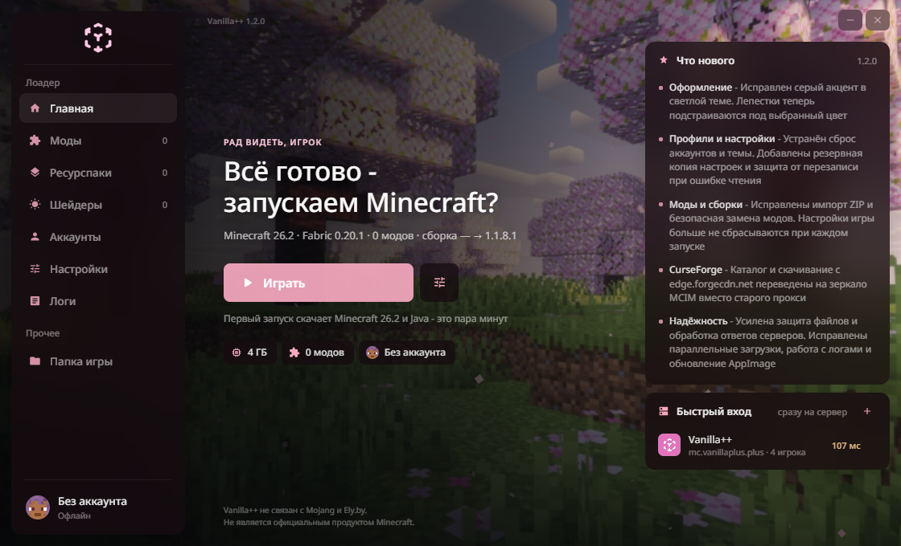
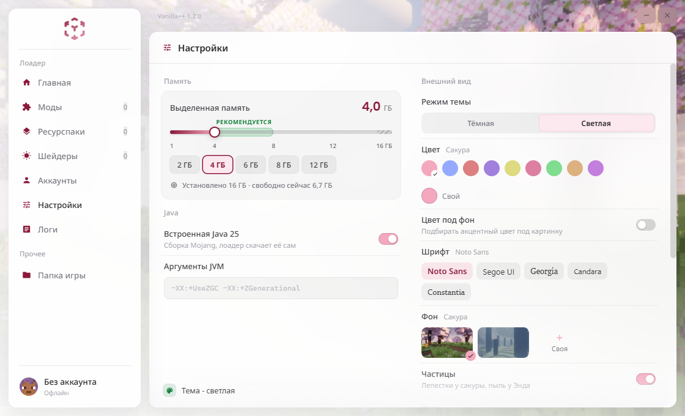
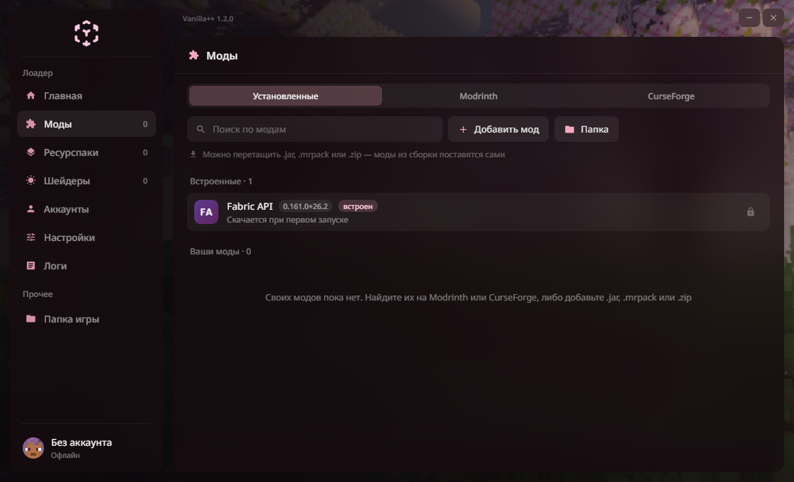
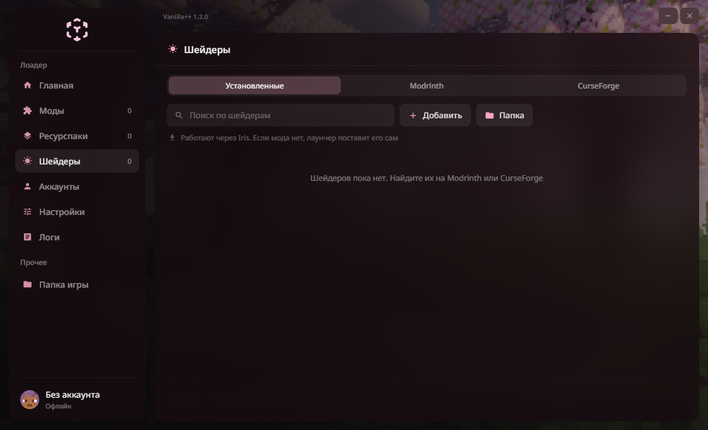
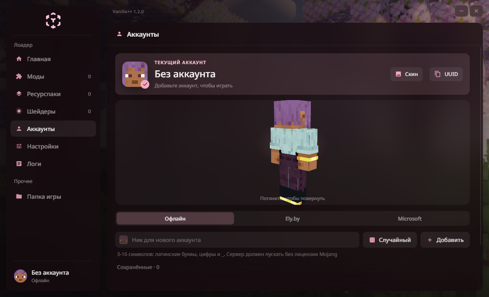
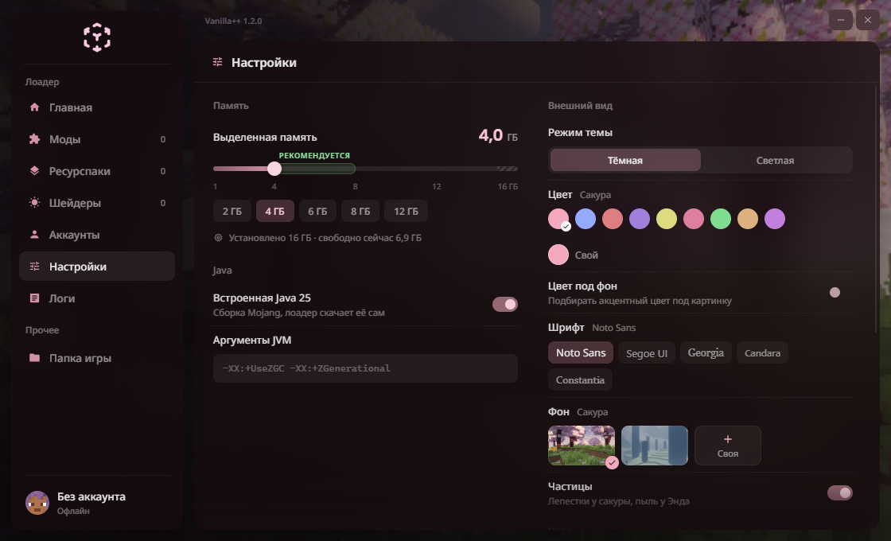
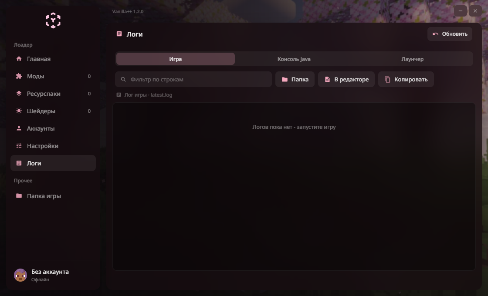

<div align="center">
  

  # Vanilla++

  A Minecraft launcher for the **mc.vanillaplus.plus** server. Installs the game,
  Java and mods, keeps everything current, starts with a couple of clicks.

  [](https://github.com/pashtetusss777/vpp-launcher/releases/latest)
  [](https://github.com/pashtetusss777/vpp-launcher/releases)
  [](https://github.com/pashtetusss777/vpp-launcher/actions/workflows/release.yml)
  [](LICENSE)

  **Windows · macOS · Linux** · Electron · Fabric

  [Русский](README.md) | English
</div>

## Screenshots

| | |
|---|---|
|  |  |
|  |  |
|  |  |
|  |  |
|  | |

## What it does

- **One-click play.** The launcher downloads Minecraft, Fabric and Mojang's Java by itself and picks the version and memory your machine needs.
- **The server modpack.** The pack lives on Modrinth and syncs on every launch. It does not wipe your game settings.
- **Mod catalog.** Search on Modrinth and CurseForge, with categories, versions and dependencies. Every download is checked against sha1 and sha256.
- **Resource packs and shaders.** One toggle each. Iris for shaders gets installed on its own if it is missing.
- **Accounts.** Microsoft, Ely.by, or a plain nickname for servers that allow it. Skins can be changed right in the launcher.
- **Your own mods and packs.** Drag a `.jar`, `.mrpack` or `.zip` into the window, the launcher handles the rest.
- **Launcher updates.** Press the button on the banner and everything else happens on its own. Every update file is checked against its checksum.
- **Logs.** A live log tail in the UI and an honest take on crashes instead of panicking over every hiccup.

## Installation

Grab a file from the [latest release](https://github.com/pashtetusss777/vpp-launcher/releases/latest):

| Platform | File |
|---|---|
| Windows | `VanillaPlusPlus-<version>-x64.exe` (installer) or `-portable.zip` |
| macOS | `-arm64.pkg` / `-arm64.zip`, `-x64.pkg` / `-x64.zip` |
| Linux | `-x64.AppImage`, `-x64.tar.gz`, `-amd64.deb`, `-x64.pacman` (arm64 variants too) |

The launcher updates itself, just press the button on the banner. If an update goes wrong, the previous version stays next to it in a `Vanilla++.previous-*` folder, so you are never left launcherless.

> **Disclaimer.** Vanilla++ is not affiliated with Mojang or Ely.by. Not an official Minecraft product.

## What data the launcher collects

Only with explicit consent: the question shows up once on first launch, and the answer can be changed in settings at any time.

| Collected | Never collected |
|---|---|
| OS, version, architecture, CPU cores, RAM size, GPU model | IP addresses |
| Launcher, Minecraft and modpack versions | Nicknames, accounts, skins |
| Game session durations, exit code, whether it crashed | The contents of your folders and files |
| A random installation id, not linked to a person | Anything else |

The data lands in the server's Supabase table; only the launcher itself can write there. The schema and sample reports live in [`docs/analytics.sql`](docs/analytics.sql).

The launcher can also ask Windows to run the game on the discrete GPU: a standard per-user registry entry (one value for our Java), removed when the settings toggle is turned off. This choice never reaches analytics.

## Building from source

```sh
npm ci         # dependencies, Node 22+ required
npm start      # run from source
npm test       # 51 regression tests, no network and no game launch
npm run dist   # builds for the current platform
```

## Settings and profile recovery

- Windows: `%APPDATA%\Vanilla++\settings.json`. Theme and accounts are plain JSON, tokens live separately in the encrypted `accountSecrets` field. The older `enc1.` format is still readable.
- Before the first migration of an old file a `settings.json.bak` copy is created. If the settings file is damaged, the launcher tells you instead of silently resetting the profile.
- For a full backup of encrypted settings, keep the `Local State` file from the same folder along with them: on Windows the decryption key is bound to the OS user. And no, do not publish these files.

## FAQ

**Does the launcher collect any data?**
Only with your consent: your system, versions and session lengths. The full list is in "What data the launcher collects", and settings let you turn it off anytime.

**My laptop has two GPUs. What does the launcher do?**
By default it asks Windows to run the game on the most powerful GPU, using the standard per-app preference from Windows display settings, written into your user profile. Nothing system-wide changes and no other programs are touched. Turn off the "Дискретная графика" toggle in settings and the entry is removed.

**Where are the game files and mods?**
In `%APPDATA%\.vanilla-plus-plus`. The "Папка игры" button in the launcher opens it for you. Mods live in `mods`, logs in `launcher`.

**Can I play without a Mojang license?**
Yes, add an offline account with a nickname. This only works on servers that allow it, and our server does.

**I already have .minecraft or Prism installed. Download everything again?**
No. The launcher finds ready libraries and assets from other launchers on your machine and takes them from there, so much less gets downloaded.

**How much memory should the game get?**
4 GB is enough for vanilla, go with 6 or 8 for mods. More is not better: the game never gets all of the machine's memory anyway.

**How do I add my own mod?**
Drag a `.jar` into the launcher window or add it through the catalog. Toggle it on and off, or remove it with a one-click undo.

**Can I change the Minecraft version?**
The version comes from the server modpack and is not picked separately. That way all players sit on the same version and the same pack.

**My accounts and theme disappeared after an update. What now?**
This is fixable: close the launcher and check the "Settings and profile recovery" section above. The `settings.json.bak` copy is usually right there.

**My antivirus complains about updates.**
Updates on Windows replace files silently through a hidden script, which some antivirus products dislike. If in doubt, compare the file's sha256 with the digest from the release.

**CurseForge is not responding.**
The catalog runs through the unofficial [MCIM](https://www.mcimirror.top) mirror, which can be down on some days or networks. Modrinth is reached directly and does not depend on it.

**The game crashed. What do I do?**
Open "Логи" in the launcher: it shows the log tail and the crash report. Most often a single mod is to blame, switch it off and start again.

## License

[GPL-3.0-only](LICENSE)
