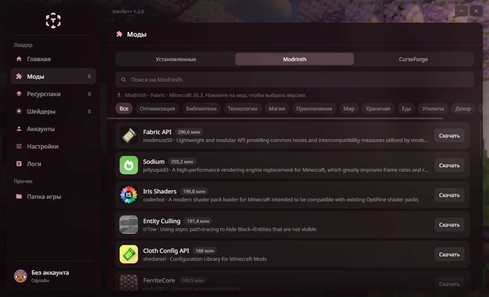
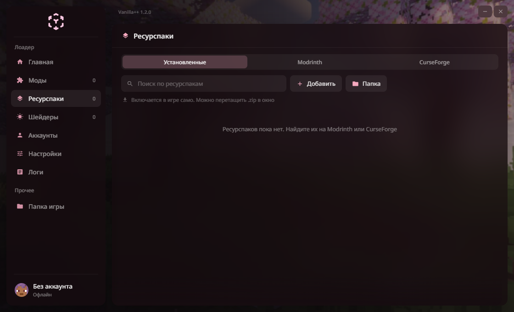

<div align="center">
  

  # Vanilla++

  A Minecraft launcher for the **mc.vanillaplus.plus** server: installs the game, Java and mods, keeps everything up to date, and starts with a couple of clicks.

  [](https://github.com/pashtetusss777/vpp-launcher/releases/latest)
  [](https://github.com/pashtetusss777/vpp-launcher/releases)
  [](https://github.com/pashtetusss777/vpp-launcher/actions/workflows/release.yml)
  [](LICENSE)

  **Windows · macOS · Linux** · Electron · Fabric

  [Русский](README.md) | English
</div>

## Screenshots

| | |
|---|---|
|  |  |
|  |  |
|  |  |
|  |  |
|  | |

## Features

- **One-click play** — the launcher downloads Minecraft, Fabric and Mojang's Java by itself and picks the right version and memory.
- **Auto-synced modpack** — the Modrinth pack syncs on every launch; configs apply once per pack update instead of resetting your settings.
- **Mod catalog** — search on Modrinth and CurseForge (via the [MCIM](https://www.mcimirror.top/guide/platform/curseforge) mirror) with categories, versions and dependencies; every download is verified against sha1/sha256.
- **Resource packs and shaders** — one toggle each; a missing Iris is installed automatically.
- **Accounts** — Microsoft, Ely.by and offline; skins, a 3D viewer and in-launcher skin uploads.
- **Modpacks and archives** — install `.mrpack`, `.zip` mod bundles and CurseForge modpacks by dragging them into the window.
- **Launcher self-updates** — silent file replacement on Windows, `.pkg` and AppImage elsewhere; every update file is checked against GitHub's sha256 digests.
- **Logs and crash reports** — a live log tail in the UI, telling real crashes apart from false watchdog reports.

## Installation

Grab a file from the [latest release](https://github.com/pashtetusss777/vpp-launcher/releases/latest):

| Platform | File |
|---|---|
| Windows | `VanillaPlusPlus-<version>-x64.exe` (installer) or `-portable.zip` |
| macOS | `-arm64.pkg` / `-arm64.zip`, `-x64.pkg` / `-x64.zip` |
| Linux | `-x64.AppImage`, `-x64.tar.gz`, `-amd64.deb`, `-x64.pacman` (arm64 variants too) |

The launcher updates itself: press "Обновить" on the banner. On Windows the installer unpacks the new version next to the old one and keeps the previous install as `Vanilla++.previous-*`, so a failed update never leaves you launcherless.

> **Disclaimer.** Vanilla++ is not affiliated with Mojang or Ely.by. Not an official Minecraft product.

## Building from source

```sh
npm ci         # dependencies (Node 22+)
npm start      # run from source
npm test       # 46 regression tests, no network and no game launch
npm run dist   # builds for the current platform (Windows: installer + portable)
```

## Settings and profile recovery

- Windows: `%APPDATA%\Vanilla++\settings.json`. Looks and profiles are plain JSON; account tokens live separately in the encrypted `accountSecrets` field; the older fully-encrypted `enc1.` format is still readable.
- Before the first migration of an old file a `settings.json.bak` copy is created. If the settings file is damaged, the launcher stops with an error instead of silently resetting your profile.
- For a full backup of encrypted settings, keep `Local State` from the same folder together with them: on Windows the decryption key is bound to the OS user. Never publish these files.

## FAQ

**CurseForge is down / won't download.** The catalog uses the unofficial [MCIM](https://www.mcimirror.top) mirror, which can be unavailable on some days or networks. Modrinth is reached directly and does not depend on it.

**Antivirus complains about the installer/update.** Updates on Windows replace files silently through a hidden script — some antivirus products dislike that. Update files are covered by sha256 digests from the release; verify them if in doubt.

**The game crashed after installing a mod.** Open "Логи" in the launcher — it shows the log tail and crash report; most often a single mod is to blame, switch it off.

## License

[GPL-3.0-only](LICENSE)
