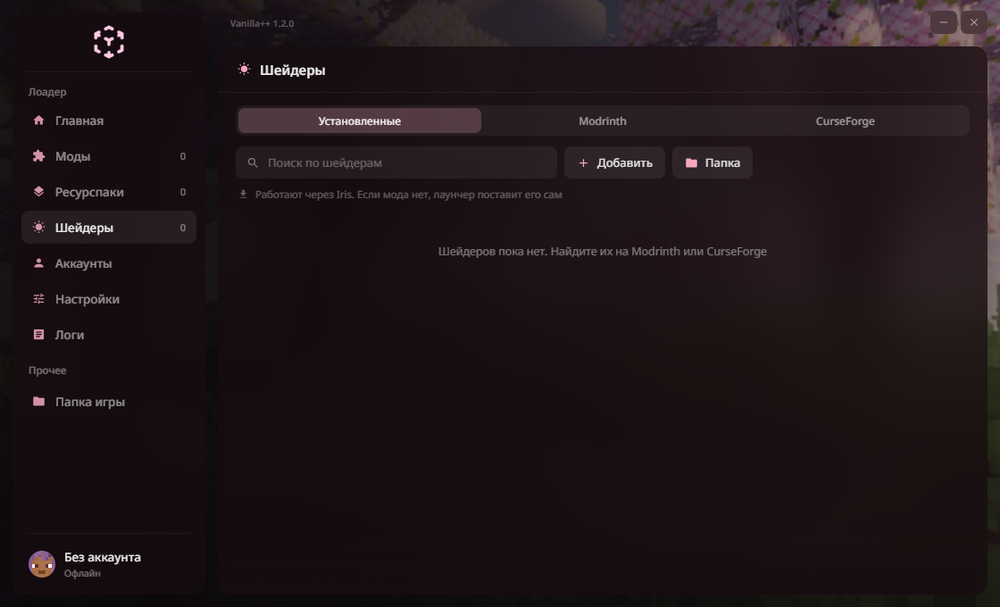

<div align="center">
  

  # Vanilla++

  Лаунчер Minecraft для сервера **mc.vanillaplus.plus**. Ставит игру, Java и моды,
  следит за обновлениями, запускается в пару кликов.

  [](https://github.com/pashtetusss777/vpp-launcher/releases/latest)
  [](https://github.com/pashtetusss777/vpp-launcher/releases)
  [](https://github.com/pashtetusss777/vpp-launcher/actions/workflows/release.yml)
  [](LICENSE)

  **Windows · macOS · Linux** · Electron · Fabric

  Русский | [English](README.EN.md)
</div>

## Скриншоты

| | |
|---|---|
|  |  |
|  |  |
|  |  |
|  |  |
|  | |

## Что умеет

- **Игра в один клик.** Лаунчер сам качает Minecraft, Fabric и Java от Mojang. Версия и память подбираются под вашу машину.
- **Сборка с сервера.** Модпак лежит на Modrinth и обновляется при каждом запуске. Ваши настройки игры он не затирает.
- **Каталог модов.** Поиск на Modrinth и CurseForge, категории, версии, зависимости. Всё скачивается с проверкой по sha1 и sha256.
- **Ресурспаки и шейдеры.** Включаются и выключаются тумблером. Iris для шейдеров поставится сам, если его нет.
- **Аккаунты.** Microsoft, Ely.by и обычный ник для серверов без лицензии. Скины можно менять прямо в лаунчере.
- **Свои моды и сборки.** Перетащите `.jar`, `.mrpack` или `.zip` в окно, остальное лаунчер сделает сам.
- **Обновления лаунчера.** Нажимаете «Обновить» на плашке, остальное происходит без вас. Каждый файл обновления сверяется с контрольной суммой.
- **Логи.** Живой хвост лога в интерфейсе, честный разбор крашей вместо паники на каждый чих.

## Установка

Заберите файл из [последнего релиза](https://github.com/pashtetusss777/vpp-launcher/releases/latest):

| Платформа | Файл |
|---|---|
| Windows | `VanillaPlusPlus-<версия>-x64.exe` (установщик) или `-portable.zip` |
| macOS | `-arm64.pkg` / `-arm64.zip`, `-x64.pkg` / `-x64.zip` |
| Linux | `-x64.AppImage`, `-x64.tar.gz`, `-amd64.deb`, `-x64.pacman` (и arm64 варианты) |

Лаунчер обновляется сам, достаточно нажать кнопку на плашке. Если обновление не прошло, предыдущая версия остаётся рядом в папке `Vanilla++.previous-*`, так что без лаунчера вы не останетесь.

> **Дисклеймер.** Vanilla++ не связан с Mojang и Ely.by. Это неофициальный продукт Minecraft.

## Сборка из исходников

```sh
npm ci         # зависимости, нужен Node 22+
npm start      # запуск из исходников
npm test       # 46 регрессионных тестов, без сети и без запуска игры
npm run dist   # сборки для текущей платформы
```

## Настройки и восстановление профиля

- Windows: `%APPDATA%\Vanilla++\settings.json`. Тема и аккаунты лежат в обычном JSON, токены отдельно в зашифрованном поле `accountSecrets`. Старый формат `enc1.` тоже читается.
- Перед первой миграцией старого файла создаётся копия `settings.json.bak`. Если файл настроек повреждён, лаунчер скажет об этом и не станет молча обнулять профиль.
- Для полной резервной копии зашифрованных настроек сохраняйте вместе с ними файл `Local State` из той же папки: на Windows ключ расшифровки привязан к пользователю системы. И да, эти файлы публиковать не стоит.

## FAQ

**Где лежат файлы игры и моды?**
В `%APPDATA%\.vanilla-plus-plus`. Кнопка «Папка игры» в лаунчере открывает её сама. Моды в папке `mods`, логи в `launcher`.

**Можно ли играть без лицензии Mojang?**
Да, добавьте офлайн аккаунт по нику. Заходить так можно только на серверы, которые это разрешают, наш сервер пускает.

**У меня уже стоит .minecraft или Prism. Всё качать заново?**
Нет. Лаунчер видит готовые библиотеки и ассеты у других лаунчеров на компьютере и забирает их оттуда, так что качается сильно меньше.

**Сколько памяти выделять игре?**
4 ГБ ванили хватит, для модов берите 6 или 8. Больше не значит лучше: вся память машины игре всё равно не отдадут.

**Как поставить свой мод?**
Перетащите `.jar` в окно лаунчера или добавьте через каталог. Включается и выключается тумблером, удаляется с возможностью вернуть.

**Можно ли поменять версию Minecraft?**
Версию задаёт сборка с сервера, отдельно её не выбирают. Так все игроки сидят на одной версии и модпаке.

**После обновления пропали аккаунты и тема. Что делать?**
Такое лечится: закройте лаунчер и посмотрите раздел «Настройки и восстановление профиля» выше. Копия `settings.json.bak` обычно на месте.

**Антивирус ругается на обновление.**
Обновление на Windows заменяет файлы тихо, через скрытый скрипт, некоторым антивирусам это не нравится. Если сомневаетесь, сверьте sha256 файла с дайджестом из релиза.

**CurseForge не отвечает.**
Каталог работает через неофициальное зеркало [MCIM](https://www.mcimirror.top), оно бывает недоступно в отдельные дни или сети. Modrinth работает напрямую и от зеркала не зависит.

**Игра вылетела. Что делать?**
Откройте «Логи» в лаунчере: там хвост лога и crash-отчёт. Чаще всего виноват конкретный мод, выключите его тумблером и запустите снова.

## Лицензия

[GPL-3.0-only](LICENSE)
