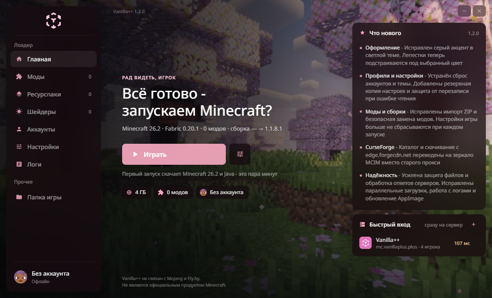
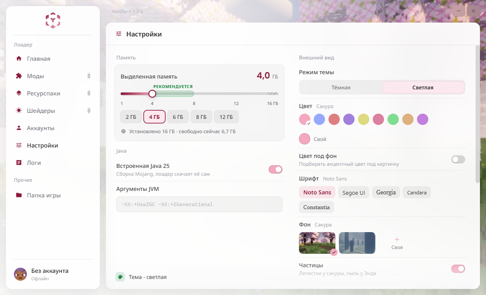
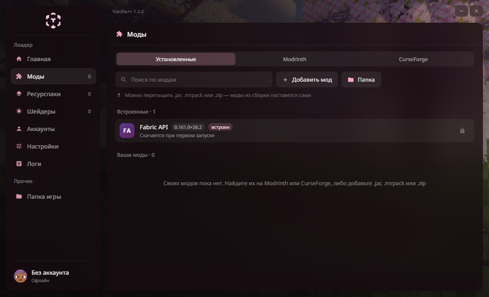
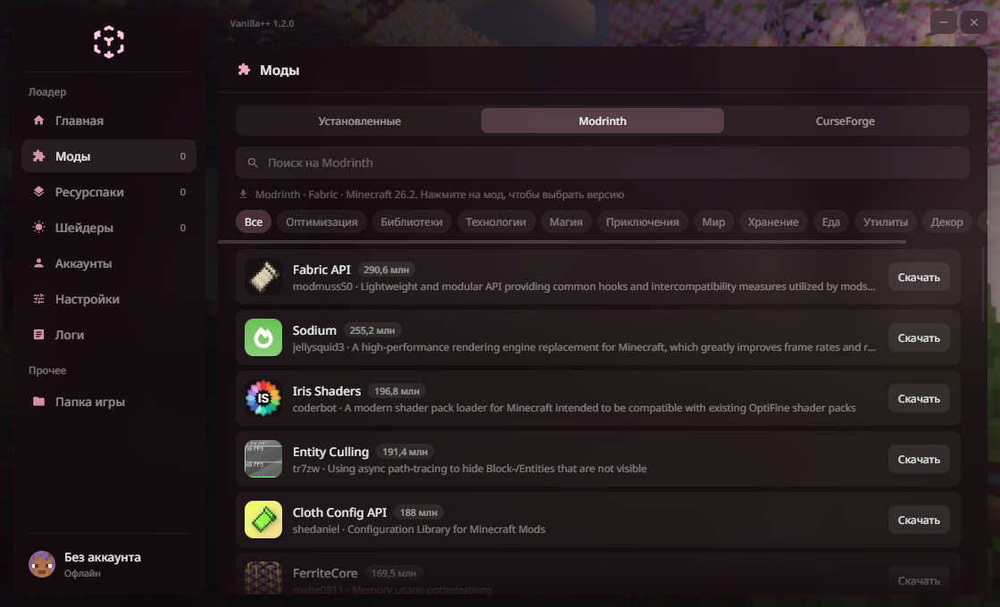
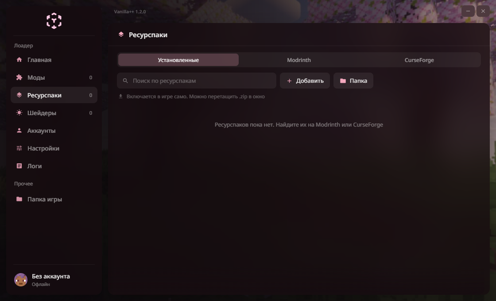
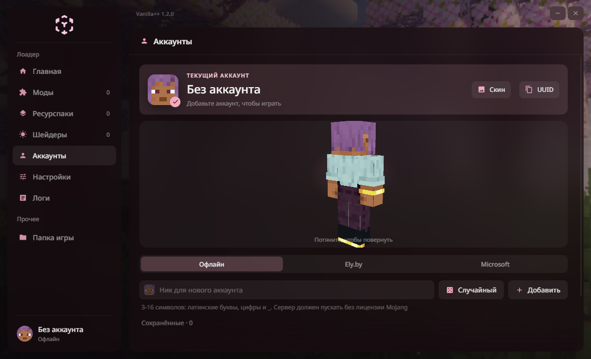
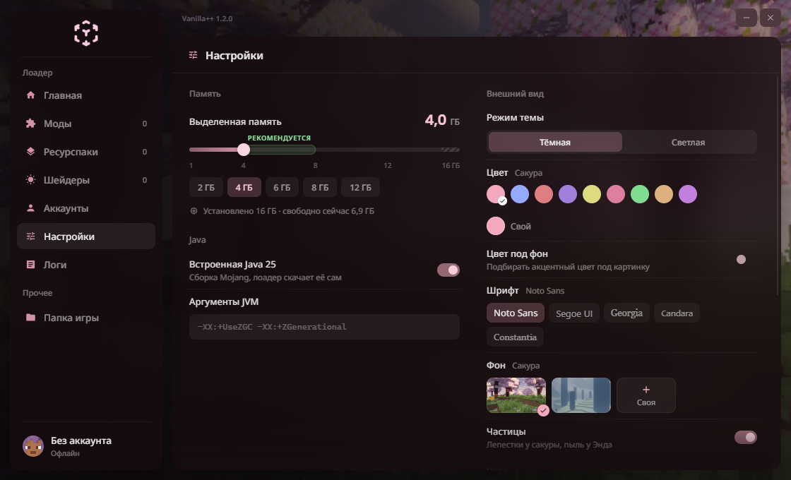
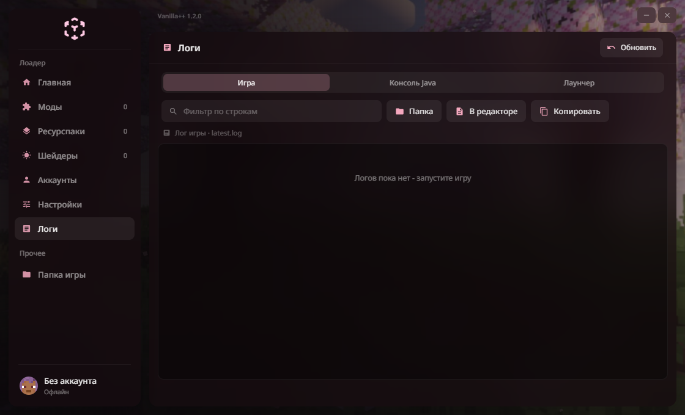

<div align="center">
  

  # Vanilla++

  Лаунчер Minecraft для сервера **mc.vanillaplus.plus**: ставит игру, Java и моды, следит за обновлениями и запускается в пару кликов.

  [](https://github.com/pashtetusss777/vpp-launcher/releases/latest)
  [](https://github.com/pashtetusss777/vpp-launcher/releases)
  [](https://github.com/pashtetusss777/vpp-launcher/actions/workflows/release.yml)
  [](LICENSE)

  **Windows · macOS · Linux** · Electron · Fabric

  Русский | [English](README.EN.md)
</div>

## Скриншоты

| | |
|---|---|
|  |  |
|  |  |
|  |  |
|  |  |
|  | |

## Возможности

- **Игра в один клик** — лаунчер сам скачивает Minecraft, Fabric и Java от Mojang, выбирает нужную версию и память.
- **Модпак с автообновлением** — сборка с Modrinth синхронизируется при каждом запуске, конфиги применяются один раз при обновлении, а не затирают ваши настройки.
- **Каталог модов** — поиск на Modrinth и CurseForge (через зеркало [MCIM](https://www.mcimirror.top/guide/platform/curseforge)) с категориями, версиями и зависимостями; все загрузки проверяются по sha1/sha256.
- **Ресурспаки и шейдеры** — включение/выключение в один тумблер, недостающий Iris ставится сам.
- **Аккаунты** — Microsoft, Ely.by и офлайн; скины, 3D-просмотр, смена скина прямо из лаунчера.
- **Модпаки и архивы** — установка `.mrpack`, `.zip` с модами и импорт сборок CurseForge перетаскиванием в окно.
- **Автообновление лаунчера** — тихая замена файлов на Windows, `.pkg` и AppImage на других платформах; все файлы обновления сверяются с контрольными суммами GitHub.
- **Логи и краш-отчёты** — живой хвост лога в интерфейсе, распознавание реальных крашей против ложных watchdog-отчётов.

## Установка

Скачайте файл из [последнего релиза](https://github.com/pashtetusss777/vpp-launcher/releases/latest):

| Платформа | Файл |
|---|---|
| Windows | `VanillaPlusPlus-<версия>-x64.exe` (установщик) или `-portable.zip` |
| macOS | `-arm64.pkg` / `-arm64.zip`, `-x64.pkg` / `-x64.zip` |
| Linux | `-x64.AppImage`, `-x64.tar.gz`, `-amd64.deb`, `-x64.pacman` (и arm64-варианты) |

Лаунчер обновляется сам: достаточно нажать «Обновить» на плашке. Установщик сначала распаковывает новую версию рядом и сохраняет предыдущую установку как `Vanilla++.previous-*`, так что неудачное обновление не оставит вас без лаунчера.

> **Дисклеймер.** Vanilla++ не связан с Mojang и Ely.by. Это неофициальный продукт Minecraft.

## Сборка из исходников

```sh
npm ci         # зависимости (Node 22+)
npm start      # запуск из исходников
npm test       # 46 регрессионных тестов, без сети и без запуска игры
npm run dist   # сборки для текущей платформы (Windows: установщик + portable)
```

## Настройки и восстановление профиля

- Windows: `%APPDATA%\Vanilla++\settings.json`. Оформление и профили — обычный JSON, токены аккаунтов хранятся отдельно в зашифрованном поле `accountSecrets`; старый формат `enc1.` тоже читается.
- Перед первой миграцией старого файла создаётся `settings.json.bak`. Если файл настроек повреждён, лаунчер останавливается с ошибкой, а не молча заменяет профиль пустым.
- Для полной резервной копии зашифрованных настроек сохраняйте вместе с ними `Local State` из той же папки: на Windows ключ расшифровки привязан к пользователю ОС. Не публикуйте эти файлы.

## FAQ

**CurseForge не отвечает / не скачивает.** Каталог работает через неофициальное зеркало [MCIM](https://www.mcimirror.top) — оно может быть недоступно в отдельные дни или в отдельных сетях. Modrinth работает напрямую и не зависит от зеркала.

**Антивирус ругается на установщик/обновление.** Обновление на Windows заменяет файлы тихо, через скрытый скрипт — некоторые антивирусы это не любят. Файлы обновления подписаны дайджестами sha256 из релиза, сверяйте их при сомнениях.

**Игра закрылась с ошибкой после мода.** Откройте «Логи» в лаунчере — там хвост лога и crash-отчёт; чаще всего виноват конкретный мод, выключите его тумблером.

## Лицензия

[GPL-3.0-only](LICENSE)
